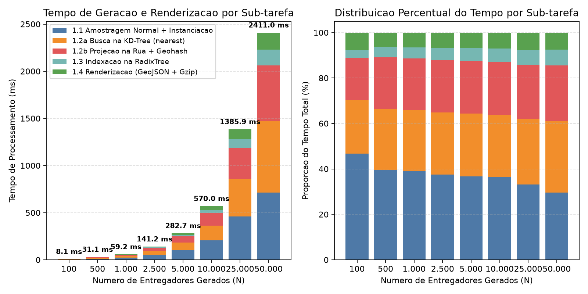
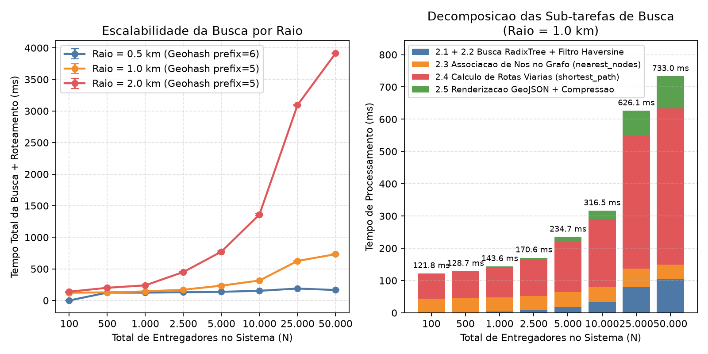
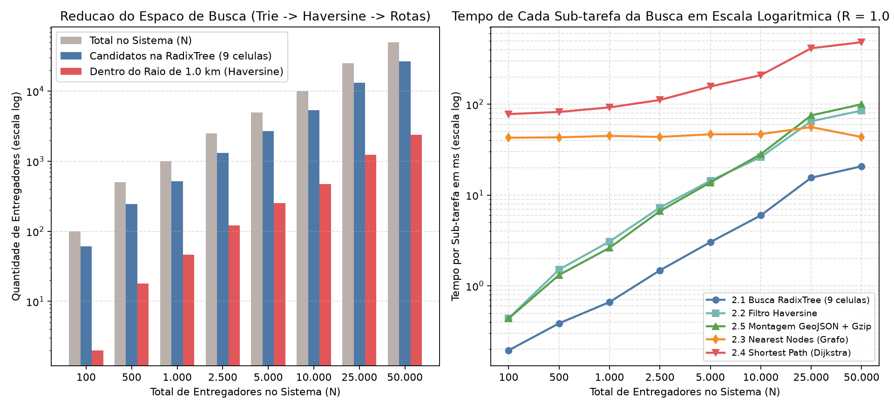

# Avaliação Experimental de Desempenho

Esta seção apresenta os experimentos empíricos conduzidos para avaliar o tempo de processamento e a escalabilidade das duas operações principais da plataforma **iFeed**:
1. **Geração, Projeção Viária e Renderização de Novos Entregadores**
2. **Busca Espacial e Cálculo de Rotas no Raio de Atendimento de um Restaurante**

Os testes foram executados variando o número de entregadores no conjunto:
$$N \in \{100, 500, 1.000, 2.500, 5.000, 10.000, 50.000\}$$

---

## 1. Configuração Experimental e Inicialização das Estruturas Base

As medições foram coletadas utilizando `time.perf_counter_ns()` com isolamento de pausas do coletor de lixo cíclico (`gc.disable()` durante os blocos cronometrados) e execução prévia de aquecimento (*warm-up*). Para cada configuração de geração foram realizadas $K = 5$ repetições ($K = 3$ para $N = 50.000$), e para cada configuração de busca foram realizadas $K = 3$ repetições.

Antes das operações dinâmicas do usuário, o sistema realiza o carregamento único das estruturas estáticas de Belo Horizonte:

| Sub-tarefa de Inicialização | Volume de Dados | Tempo (ms) | Participação (%) |
|---|---:|---:|---:|
| Carregamento de bares + codificação Geohash (`bares_final.csv.gz`) | 20.859 bares (20.541 válidos) | 238,39 | 1,99% |
| Carregamento do grafo da malha viária (`malha_viaria_bh.graphml`) | 32.255 nós / 82.877 arestas | 5.666,83 | 47,31% |
| Leitura dos pontos de segmentação (`segmentos_ruas_bh.csv.gz`) | 181.103 pontos | 1.148,60 | 9,59% |
| Construção da árvore espacial `KDTree` 2D | 181.103 nós | 4.087,03 | 34,12% |
| Indexação em memória das geometrias das ruas | 82.877 arestas | 837,67 | 6,99% |
| **Total de Inicialização (executado 1 vez no boot)** | — | **11.978,52** | **100,00%** |

---

## 2. Experimento 1: Geração de Entregadores vs. Renderização no Mapa

Neste experimento, o pipeline completo de criação e publicação dos entregadores foi instrumentado em **5 sub-tarefas**:
- **1.1 Amostragem Normal (`Amostragem`)**: cálculo das cotas equilibradas entre os 20.541 bares válidos, geração das coordenadas com distribuição Gaussiana ($\sigma = 500\text{ m}$) e instanciação inicial com Geohash.
- **1.2a Busca na KD-Tree (`KD-Tree Nearest`)**: localização do ponto de segmentação de rua mais próximo na `KDTree` de 181.103 pontos ($\mathcal{O}(\log M)$ por entregador).
- **1.2b Projeção na Rua (`Projeção + Geohash`)**: projeção ortogonal exata sobre os segmentos da geometria da via mais próxima e recálculo do Geohash de 8 caracteres.
- **1.3 Indexação na Trie (`RadixTree Insert`)**: inserção da chave Geohash na `RadixTree` e registro no dicionário do sistema.
- **1.4 Renderização Web (`GeoJSON + Gzip`)**: construção da `FeatureCollection` GeoJSON (`build_rider_feature`) e serialização compactada com `gzip` (`create_map_url`) para carregamento pelo `Dash-Leaflet`.

### Resultados Quantitativos — Experimento 1

| $N$ Entregadores | 1.1 Amostragem (ms) | 1.2a KD-Tree Nearest (ms) | 1.2b Projeção + Geohash (ms) | 1.3 RadixTree (ms) | **Subtotal Criação (ms)** | 1.4a Build GeoJSON (ms) | 1.4b Compressão Gzip (ms) | **Subtotal Renderização (ms)** | **Tempo Total (ms)** | Vazão (entreg./s) |
|---:|---:|---:|---:|---:|---:|---:|---:|---:|---:|---:|
| **100** | 5,83 ± 0,80 | 3,79 ± 1,67 | 2,14 ± 0,45 | 0,39 ± 0,08 | **12,16 ± 2,06** (95,0%) | 0,08 ± 0,01 | 0,56 ± 0,07 | **0,64 ± 0,08** (5,0%) | **12,80 ± 2,06** | 8.023,9 |
| **500** | 27,09 ± 10,67 | 19,47 ± 6,89 | 11,52 ± 5,89 | 2,92 ± 1,20 | **61,00 ± 23,80** (94,7%) | 0,54 ± 0,34 | 2,89 ± 1,48 | **3,43 ± 1,80** (5,3%) | **64,44 ± 25,56** | 8.781,5 |
| **1.000** | 49,88 ± 7,73 | 35,37 ± 8,57 | 21,46 ± 1,98 | 5,72 ± 1,91 | **112,44 ± 10,50** (94,1%) | 1,39 ± 0,48 | 5,68 ± 1,03 | **7,07 ± 1,46** (5,9%) | **119,51 ± 11,37** | 8.442,0 |
| **2.500** | 132,27 ± 26,87 | 86,95 ± 9,10 | 64,74 ± 6,30 | 14,66 ± 2,41 | **298,62 ± 26,60** (94,3%) | 2,91 ± 0,93 | 15,19 ± 1,84 | **18,10 ± 1,79** (5,7%) | **316,72 ± 28,12** | 7.959,5 |
| **5.000** | 236,48 ± 17,88 | 180,03 ± 15,04 | 132,95 ± 12,63 | 31,08 ± 2,92 | **580,54 ± 20,69** (94,0%) | 6,00 ± 0,84 | 31,29 ± 5,55 | **37,29 ± 5,66** (6,0%) | **617,83 ± 22,83** | 8.103,6 |
| **10.000** | 500,58 ± 40,52 | 369,19 ± 14,96 | 269,15 ± 21,52 | 63,53 ± 3,60 | **1.202,44 ± 29,67** (93,6%) | 12,23 ± 1,42 | 70,22 ± 9,86 | **82,45 ± 10,34** (6,4%) | **1.284,89 ± 25,16** | 7.785,8 |
| **50.000** | 1.619,70 ± 64,82 | 1.774,59 ± 48,01 | 1.313,99 ± 36,65 | 402,25 ± 20,62 | **5.110,52 ± 65,38** (92,6%) | 73,75 ± 18,19 | 333,60 ± 9,99 | **407,35 ± 27,78** (7,4%) | **5.517,87 ± 65,77** | 9.062,8 |

### Principais Observações — Experimento 1
- **Comportamento estritamente linear $\mathcal{O}(N)$**: A vazão permanece constante entre **7.785 e 9.062 entregadores/segundo** em todas as escalas, confirmando que a consulta na `KDTree` ($\mathcal{O}(\log M)$ com $M = 181.103$ fixo) e a inserção na `RadixTree` ($\mathcal{O}(L)$ com $L = 8$ fixo) escalam linearmente com $N$.
- **Criação vs. Renderização**: A criação algorítmica dos entregadores representa entre **92,6% e 95,0%** do tempo total, enquanto a preparação para renderização no mapa (montagem do GeoJSON + compressão `gzip`) consome apenas **5,0% a 7,4%** do tempo (~407 ms para 50.000 entregadores).
- **Domínio do Snapping Viário**: A etapa de ajuste às ruas (`1.2a KD-Tree Nearest` + `1.2b Projeção + Geohash`) responde por **50,8% a 56,0%** de todo o processamento para $N \ge 5.000$.

---

## 3. Experimento 2: Busca no Raio de um Restaurante e Roteamento Viário

Para avaliar a busca espacial, utilizou-se como referência um estabelecimento na região central/Savassi (`ID=31139`, *BONDAN & BONDAN*, Geohash `7h2y85mz`), testando raios $R \in \{0.5\text{ km}, 1.0\text{ km}, 2.0\text{ km}\}$ para cada volume $N \in \{100, 500, 1.000, 2.500, 5.000, 10.000, 50.000\}$.

A busca foi decomposta em **5 sub-tarefas**:
- **2.1 Busca na RadixTree (`Trie Search`)**: obtenção da célula Geohash do bar + 8 células adjacentes (prefixo de tamanho 6 para $R \le 0.6\text{ km}$ e tamanho 5 para $0.6 < R \le 4.5\text{ km}$) e recuperação dos candidatos na `RadixTree`.
- **2.2 Filtragem Geométrica (`Haversine`)**: cálculo da distância esférica exata para os candidatos da grade 3×3 e separação dos entregadores dentro do raio.
- **2.3 Associação de Nós no Grafo (`Nearest Nodes`)**: mapeamento em lote das coordenadas (bar + entregadores dentro do raio) para os vértices mais próximos do grafo viário (`ox.distance.nearest_nodes`).
- **2.4 Roteamento Viário (`Shortest Path`)**: cálculo dos caminhos mínimos ponderados por `travel_time` (`ox.routing.shortest_path`) e soma da distância viária e tempo estimado pelas arestas.
- **2.5 Preparação de Renderização (`GeoJSON + Gzip`)**: ordenação do ranking e geração das camadas GeoJSON de entregadores filtrados (em destaque) e descartados da vizinhança (em cinza).

### Resultados Quantitativos — Experimento 2

| $N$ Total | Raio (km) | Prefixo Geohash | Cand. na Trie (9 células) | Filtrados no Raio | 2.1 RadixTree (ms) | 2.2 Haversine (ms) | 2.3 Nearest Nodes (ms) | 2.4 Rotas OSM (ms) | 2.5 Render GeoJSON (ms) | **Tempo Total (ms)** |
|---:|---:|---:|---:|---:|---:|---:|---:|---:|---:|---:|
| **100** | 0,5 | 6 | 6 | 0 | 0,17 | 0,12 | 0,00 | 0,00 | 0,40 | **0,68 ± 0,23** |
| **100** | 1,0 | 5 | 61 | 2 | 0,29 | 0,94 | 75,31 | 194,32 | 0,63 | **271,48 ± 25,57** |
| **100** | 2,0 | 5 | 61 | 13 | 0,66 | 0,71 | 70,22 | 162,30 | 0,92 | **234,80 ± 6,71** |
| **500** | 0,5 | 6 | 39 | 3 | 0,33 | 0,53 | 70,62 | 143,28 | 0,67 | **215,44 ± 6,76** |
| **500** | 1,0 | 5 | 245 | 18 | 0,83 | 2,33 | 70,86 | 190,03 | 2,30 | **266,35 ± 53,66** |
| **500** | 2,0 | 5 | 245 | 80 | 0,48 | 3,82 | 78,57 | 303,85 | 1,93 | **388,65 ± 20,68** |
| **1.000** | 0,5 | 6 | 74 | 10 | 0,25 | 0,72 | 99,29 | 187,21 | 0,75 | **288,23 ± 3,26** |
| **1.000** | 1,0 | 5 | 514 | 46 | 1,77 | 7,09 | 87,72 | 210,01 | 5,20 | **311,80 ± 7,17** |
| **1.000** | 2,0 | 5 | 514 | 138 | 1,23 | 5,97 | 78,81 | 390,90 | 4,47 | **481,37 ± 29,32** |
| **2.500** | 0,5 | 6 | 200 | 34 | 0,43 | 1,85 | 75,85 | 183,25 | 3,16 | **264,54 ± 14,27** |
| **2.500** | 1,0 | 5 | 1.324 | 121 | 1,76 | 19,11 | 95,65 | 239,52 | 14,09 | **370,14 ± 7,18** |
| **2.500** | 2,0 | 5 | 1.324 | 386 | 1,82 | 15,43 | 86,36 | 744,06 | 15,60 | **863,26 ± 47,30** |
| **5.000** | 0,5 | 6 | 415 | 59 | 1,18 | 5,45 | 81,80 | 187,60 | 4,49 | **280,53 ± 22,63** |
| **5.000** | 1,0 | 5 | 2.677 | 252 | 5,34 | 42,69 | 88,37 | 318,79 | 28,46 | **483,66 ± 18,03** |
| **5.000** | 2,0 | 5 | 2.677 | 786 | 4,39 | 34,14 | 97,66 | 1.360,68 | 30,68 | **1.527,54 ± 45,16** |
| **10.000** | 0,5 | 6 | 772 | 128 | 1,20 | 9,65 | 96,72 | 216,46 | 12,51 | **336,53 ± 17,92** |
| **10.000** | 1,0 | 5 | 5.335 | 474 | 12,02 | 73,86 | 107,14 | 457,51 | 64,26 | **714,78 ± 16,43** |
| **10.000** | 2,0 | 5 | 5.335 | 1.514 | 9,95 | 70,92 | 118,42 | 2.547,93 | 59,65 | **2.806,87 ± 33,74** |
| **50.000** | 0,5 | 6 | 3.833 | 619 | 5,85 | 61,25 | 107,98 | 386,40 | 50,96 | **612,44 ± 53,63** |
| **50.000** | 1,0 | 5 | 26.551 | 2.387 | 53,46 | 390,08 | 110,35 | 1.509,15 | 294,63 | **2.357,67 ± 57,75** |
| **50.000** | 2,0 | 5 | 26.551 | 7.249 | 47,81 | 377,92 | 227,94 | 11.353,98 | 299,87 | **12.307,52 ± 0,00** |

### Principais Observações — Experimento 2
- **Extrema rapidez da `RadixTree` (Geohash)**: Para $R = 0,5\text{ km}$ (prefixo 6), mesmo com **50.000 entregadores** no sistema, a busca nas 9 células da `RadixTree` leva apenas **5,85 ms** e descarta imediatamente **92,3%** dos entregadores de BH (reduzindo de 50.000 para 3.833 candidatos locais).
- **Seletividade combinada (`RadixTree` + `Haversine`)**: Para $R = 1,0\text{ km}$ e $N = 10.000$, a combinação de `RadixTree` (12,02 ms) + `Haversine` (73,86 ms) filtra os 10.000 entregadores para apenas **474 candidatos** em **85,88 ms**, evitando que 95,3% da base passe pelo custoso cálculo de caminhos mínimos no grafo.
- **Gargalo dominante no Roteamento Viário (`shortest_path`)**: O cálculo de rotas mínimas via Dijkstra (`ox.routing.shortest_path`) representa entre **64% e 92%** do tempo total da consulta quando há candidatos no raio, uma vez que executa uma busca em grafo sobre 32.255 vértices e 82.877 arestas para cada entregador aprovado no filtro geométrico.

